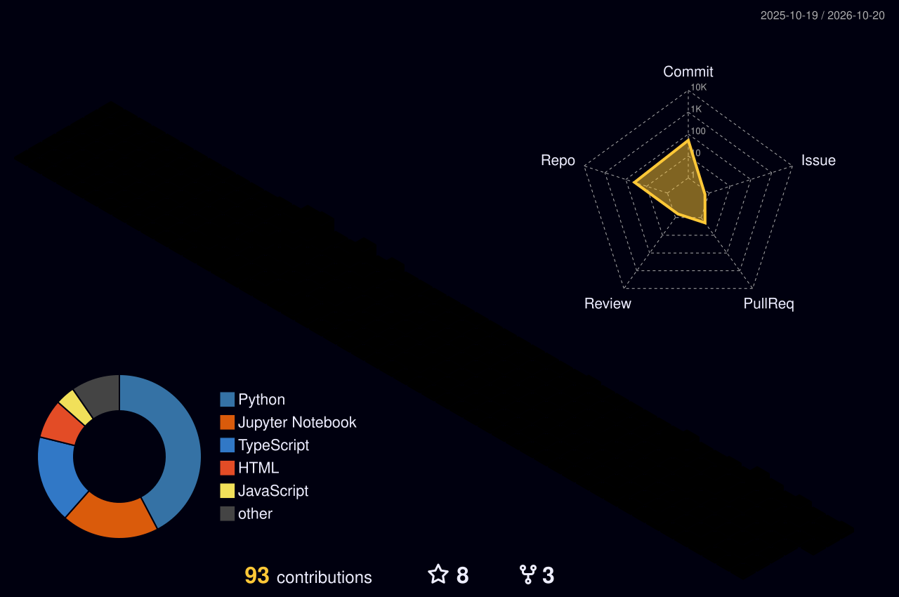

<!-- ═══════════════════════════  HEADER  ═══════════════════════════ -->


<p align="center">
  
</p>

<p align="center">
  <a href="https://github.com/batmandevx">
    
  </a>
</p>

<p align="center">
  <a href="https://ayushzupadhyay.netlify.app"></a>
  <a href="https://linkedin.com/in/ayushdevai"></a>
  <a href="mailto:ayushdevxai@gmail.com"></a>
  <a href="https://leetcode.com/u/N5uq6wDQyn/"></a>
</p>
<p align="center">
  
  
  
</p>

<!-- ═══════════════════════════  TERMINAL HERO  ═══════════════════════════ -->
<p align="center">
  
</p>


<!-- ═══════════════════════════  WHOAMI  ═══════════════════════════ -->
<h2 align="center">
  
  &nbsp;whoami
</h2>

<table align="center">
<tr>
<td width="55%" valign="middle">

```python
class Ayush:
    role     = "AI Engineer"
    focus    = ["LLM post-training",
                "RAG systems",
                "Inference optimization"]
    builds   = ["AI agents",
                "research systems",
                "full-stack products"]
    motto    = "Create with compassion."

    def hire(self):
        return "Let's build something cool."
```

</td>
<td width="45%" align="center" valign="middle">
  
</td>
</tr>
</table>



<!-- ═══════════════════════════  FOCUS  ═══════════════════════════ -->
<h2 align="center">
  
  &nbsp;what I obsess over
</h2>

<p align="center">
  
</p>

<p align="center">
  
</p>


<!-- ═══════════════════════════  ARSENAL  ═══════════════════════════ -->
<h2 align="center">
  
  &nbsp;arsenal
</h2>

<p align="center">
  
</p>

<p align="center"><b>languages</b></p>
<p align="center">
  
</p>
<p align="center"><b>web &amp; backend</b></p>
<p align="center">
  
</p>
<p align="center"><b>tools &amp; cloud</b></p>
<p align="center">
  
</p>
<p align="center"><b>ai / ml</b></p>
<p align="center">
  
</p>


<!-- ═══════════════════════════  NOW  ═══════════════════════════ -->
<h2 align="center">
  
  &nbsp;right now
</h2>

<p align="center">
  
</p>


<!-- ═══════════════════════════  STATS  ═══════════════════════════ -->
<h2 align="center">
  
  &nbsp;telemetry
</h2>

<p align="center">
  
  
</p>
<p align="center">
  
</p>

<p align="center">
  
</p>

<!-- 3D contribution city, generated by .github/workflows/profile-3d.yml -->
<p align="center">
  
</p>

<p align="center">
  
</p>

<!-- ═══════════════════════════  FUN ZONE  ═══════════════════════════ -->
<h2 align="center">
  
  &nbsp;break room
</h2>

<p align="center">
  
  
  
</p>

<div align="center">

```
   /\_/\      psst. i review all of ayush's PRs.
  ( o.o )     verdict: needs more naps.
   > ^ <      ~ mochi, chief purr-review officer
```

</div>

<p align="center">
  
</p>

<!-- Space shooter: re-enable once assets/space-shooter.gif is added to the repo
<p align="center">
  
</p>
-->

<!-- Your own contribution snake, generated by .github/workflows/snake.yml -->
<p align="center">
  <picture>
    <source media="(prefers-color-scheme: dark)" srcset="https://raw.githubusercontent.com/batmandevx/batmandevx/output/github-snake-dark.svg" />
    <source media="(prefers-color-scheme: light)" srcset="https://raw.githubusercontent.com/batmandevx/batmandevx/output/github-snake.svg" />
    
  </picture>
</p>

<!-- ═══════════════════════════  SIGN-OFF  ═══════════════════════════ -->
<p align="center">
  
</p>

<div align="center">


</div>


